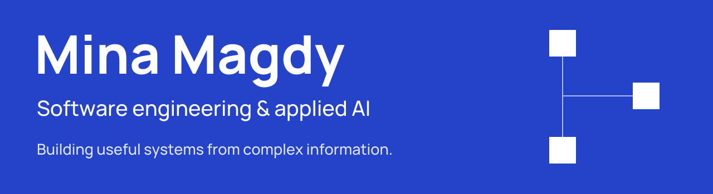
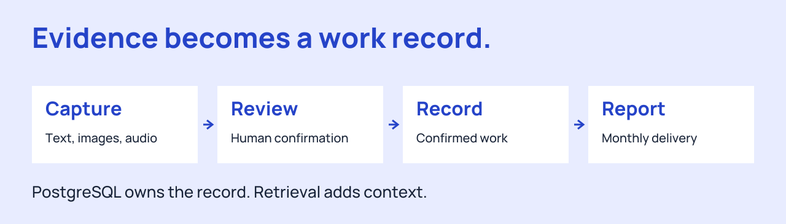
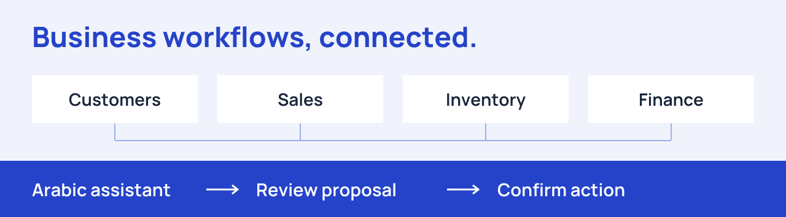
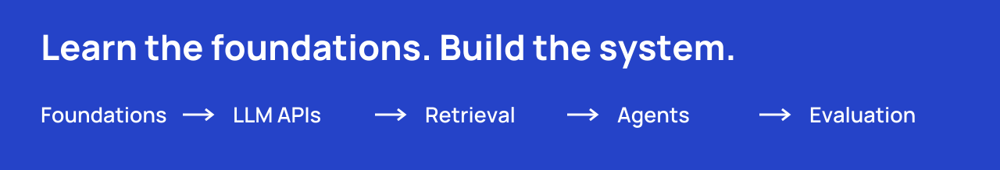

<picture>
  <source media="(max-width: 600px)" srcset="https://raw.githubusercontent.com/MONOCODE-V/MONOCODE-V/main/assets/profile-banner-mobile.svg">
  
</picture>

  <a href="https://www.linkedin.com/in/mina-magdy-b589812a4/">LinkedIn</a> ·
  <a href="mailto:minamagdypro@gmail.com">Email</a> ·
  <a href="https://codeforces.com/profile/monocodev">Codeforces</a>

I build backend systems, business applications, and AI tools that turn complex information into useful workflows. Computer Science at Alexandria University, based in Alexandria, Egypt.

**Explore:** [Client Worklog AI](#client-worklog-ai) · [CRM systems](#crm-systems) · [AI engineering](#ai-engineering) · [More software](#more-software)

## Client Worklog AI

**My main project · Local-first applied AI · Private source**

Client communication is scattered across messages, screenshots, voice notes, and developer notes. Client Worklog AI connects that evidence to reviewed work records and monthly delivery reports.

<picture>
  <source media="(max-width: 600px)" srcset="https://raw.githubusercontent.com/MONOCODE-V/MONOCODE-V/main/assets/worklog-flow-mobile.svg">
  
</picture>

- **Human review:** AI suggests; reviewed records establish the work and completion dates.
- **Reliable reporting:** PostgreSQL supplies the complete monthly work set; Chroma supports evidence retrieval.
- **Multimodal workflow:** original text, images, and audio remain connected to their reviewed meaning.

**Built with:** Python · FastAPI · PostgreSQL · SQLAlchemy · Chroma · LangChain · React · TypeScript  
**Stage:** Active development, with backend acceptance records and ongoing API/UI workflow verification.

[Explore the project overview →](projects/client-worklog-ai.md)

## CRM systems

### Star CRM / SaaS Qova

**Professional work · Business applications + an Arabic AI assistant · Private source**

A connected business application spanning customers, sales documents, inventory, treasury, reporting, roles, and field-representative workflows. The project documentation also uses the SaaS Qova name.

<picture>
  <source media="(max-width: 600px)" srcset="https://raw.githubusercontent.com/MONOCODE-V/MONOCODE-V/main/assets/crm-workflows-mobile.svg">
  
</picture>

The Arabic assistant answers business questions and prepares editable actions. People review and confirm proposed changes through the CRM workflow.

**Stack:** TypeScript · Next.js · NestJS · Prisma · PostgreSQL  
**Project family:** web application, API, shared contracts, mobile application, and AI assistant.

[Explore the CRM overview →](projects/star-crm.md)

## AI engineering

<picture>
  <source media="(max-width: 600px)" srcset="https://raw.githubusercontent.com/MONOCODE-V/MONOCODE-V/main/assets/ai-engineering-mobile.svg">
  
</picture>

| Work | Explore |
| --- | --- |
| **[LangGraph Field Guide](https://github.com/MONOCODE-V/langgraph-field-guide)** | Interactive explanations of state, routing, loops, and agent patterns. [Open the guide ↗](https://monocode-v.github.io/langgraph-field-guide/) |
| **[AI Engineering Study Guide](https://github.com/MONOCODE-V/AI-Engineering-Sheet-MINa)** | A forked learning reference covering foundations, LLM APIs, multimodal AI, RAG, agents, and evaluation. [Original guide](https://github.com/MakCoder-2004/AI-Engineering-Sheet) |
| **[AI Logger](https://github.com/MONOCODE-V/AI-Logger-)** | A NestJS prototype exploring LLM-assisted operational log analysis with Ollama and OpenAI. |

## More software

| Project | Focus |
| --- | --- |
| **Trip Management System** | Private project. |
| **[Alex Med Services](https://github.com/MONOCODE-V/Alex-Med-Services-BE)** | Appointment workflows, doctor schedules, clinics, and patient/doctor/admin roles. |
| **[Codersquare](https://github.com/MONOCODE-V/codersquare)** | TypeScript/Express backend for sharing and discussing learning resources. |
| **[Course Management API](https://github.com/MONOCODE-V/course-management-api)** | Express/MongoDB practice in course records, authentication, and profiles. |

## Tools behind the work

| Applied AI | Backend & data | Product interfaces |
| --- | --- | --- |
| Python · LangChain · Chroma | TypeScript · Node.js · NestJS · Express | React · Next.js |
| Retrieval · multimodal ingestion · evaluation | PostgreSQL · SQLAlchemy · Prisma · SQLite · MongoDB | TypeScript · role-based workflows |

---

Interested in the engineering behind these projects? [Get in touch](mailto:minamagdypro@gmail.com). Private projects are presented through high-level overviews; source code and client information stay private.

