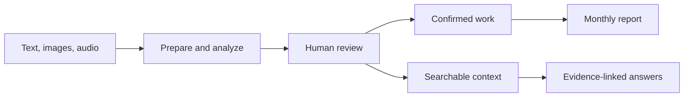

# Client Worklog AI

A local-first application for turning client communication into reviewed work records and evidence-backed monthly reports.

**Main personal project · Applied AI and software engineering**

## The problem

Client requests arrive as text, screenshots, voice notes, and developer notes. A useful monthly report must connect delivered work to its original evidence and distinguish a request from confirmed completion.

## The workflow

## Engineering choices

- **PostgreSQL owns confirmed work.** Reports select the complete monthly work set from SQL.
- **Original evidence is preserved.** Source messages and media remain available for review.
- **Retrieval adds context.** Chroma provides a rebuildable search index rather than determining report completeness.
- **AI output is reviewed.** Suggestions do not automatically establish that work was completed.
- **Evaluation is explicit.** Tests, labeled fixtures, and acceptance records distinguish implementation from workflow verification.

## Stack

Python, FastAPI, Pydantic, SQLAlchemy, Alembic, PostgreSQL, Chroma, LangChain integrations, React, and TypeScript.

## Current stage

Active development. Backend workflows and retrieval have recorded acceptance gates; the local API/UI and full workflow verification continue. This overview does not claim a public deployment or new test results.

[Source repository →](https://github.com/MONOCODE-V/client-worklog-ai)

This overview describes the engineering workflow without publishing client evidence.

