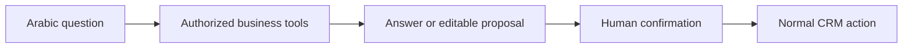

# SaaS CRM / Star CRM

Business workflow software with an Arabic AI assistant. The web and API documentation also use the SaaS Qova name following their split from the original monorepo.

**Professional project · CRM and applied AI · Private source**

## Product focus

A CRM workflow spanning customer records, sales documents, inventory, collections, reporting, and role-based access. The related repositories cover the API, web interface, shared contracts, mobile application, and AI assistant.

## AI assistant workflow

The assistant supports business questions and prepares editable actions. A person confirms proposed changes before the CRM processes them.

## Engineering themes

- Business permissions remain part of the workflow.
- Reports use returned business data.
- Proposed actions are reviewed before they are submitted.
- Shared contracts connect application components.

## Stack represented in the repositories

TypeScript, NestJS, Next.js, Prisma, PostgreSQL, and a separate tool-calling assistant service.

This high-level overview presents the project and its engineering themes. Source code, operational configuration, customer data, and internal deployment details remain private.

